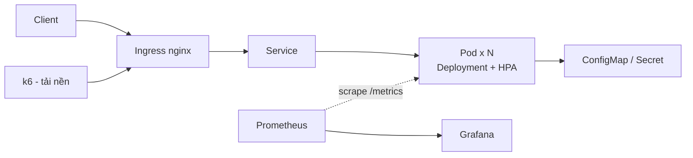

# Cloud-Computing-Project

**Đề tài 26:** Triển khai ứng dụng trên Kubernetes với tự phục hồi, co giãn và cập nhật không gián đoạn.

Demo minh họa self-healing (liveness/readiness/startup probe), autoscaling (HPA), rolling update + rollback,
PodDisruptionBudget và lưu trữ bền vững (PVC), giám sát bằng Prometheus/Grafana trên cụm Kubernetes cục bộ.

**Câu hỏi nghiên cứu:** Các controller và health probe của Kubernetes phối hợp như thế nào để duy trì trạng thái
mong muốn khi pod lỗi, tải tăng hoặc phiên bản mới gặp sự cố?

## Kiến trúc



## Cấu trúc project

```text
Cloud-Computing-Project/
├── app/                        # Ứng dụng mẫu
│   ├── main.py                 # /, /health, /ready, /load, /version, /metrics, /fail-health
│   ├── requirements.txt
│   └── Dockerfile              # chạy non-root
├── k8s/
│   ├── kind-config.yaml        # 1 control-plane + 2 worker
│   ├── secret.example.yaml     # chỉ giá trị giả (CHANGE_ME), nằm ngoài base/
│   ├── base/                   # deployment, service, configmap, ingress, hpa, pdb, pvc, storage-demo
│   └── experiments/            # cấu hình cố ý sai: liveness quá gắt, memory limit quá thấp, thiếu readiness
├── monitoring/
│   ├── prometheus-values.yaml  # values cho kube-prometheus-stack
│   ├── servicemonitor.yaml     # scrape /metrics của app
│   └── selfhealing-dashboard.json
├── load-test/
│   ├── steady.js               # tải nền ổn định (baseline, xóa pod, drain, rollout)
│   └── hpa-spike.js            # tải tăng rồi giảm cho HPA
├── scripts/
│   ├── chaos-pod-delete.sh     # xóa pod / drain node
│   ├── rollout-fail.sh         # phát hành bản lỗi + rollback
│   ├── collect-metrics.py      # xuất số liệu thô
│   └── plot-results.py         # vẽ biểu đồ từ data/results/
├── data/results/               # số liệu đo thô (CSV/JSON)
├── docs/
│   ├── reports/                # báo cáo đồ án
│   ├── results/                # ảnh dashboard, video demo (không chứa secret)
│   └── test-plan.md            # bảng kiểm thử + tiêu chí đạt
└── README.md
```

## Run guide

**Yêu cầu:** Docker, `kubectl`, `kind`, `helm`, `k6`, Python 3.10+. Máy nên có tối thiểu 4 CPU / 8 GB RAM.

**1. Dựng cụm**

```bash
git clone https://github.com/dzytan/Cloud-Computing-Project.git
cd Cloud-Computing-Project
kind create cluster --name selfhealing-demo --config k8s/kind-config.yaml
```

`kind-config.yaml` cần label `ingress-ready=true` trên control-plane và `extraPortMappings` 80/443,
nếu không Ingress sẽ không lên. Dùng k3d/minikube được nhưng phải có ít nhất 2 worker để thử drain node.

**2. Cài Metrics Server và Ingress** (ghim phiên bản, không dùng `latest`/`main`)

```bash
kubectl apply -f https://github.com/kubernetes-sigs/metrics-server/releases/download/v0.7.2/components.yaml
kubectl patch deployment metrics-server -n kube-system --type='json' \
  -p='[{"op":"add","path":"/spec/template/spec/containers/0/args/-","value":"--kubelet-insecure-tls"}]'

kubectl apply -f https://raw.githubusercontent.com/kubernetes/ingress-nginx/controller-v1.12.1/deploy/static/provider/kind/deploy.yaml
kubectl wait --namespace ingress-nginx --for=condition=ready pod \
  --selector=app.kubernetes.io/component=controller --timeout=120s
```

**3. Cài Prometheus/Grafana**

```bash
helm repo add prometheus-community https://prometheus-community.github.io/helm-charts
helm install monitoring prometheus-community/kube-prometheus-stack \
  -n monitoring --create-namespace -f monitoring/prometheus-values.yaml
```

**4. Build 3 image và nạp vào cụm** (`v1`, `v2` tốt, `v2-bad` cố ý lỗi để thử rollback)

```bash
cd app
docker build -t selfhealing-demo:v1 .
docker build -t selfhealing-demo:v2 --build-arg APP_VERSION=v2 .
docker build -t selfhealing-demo:v2-bad --build-arg APP_VERSION=v2-bad --build-arg BROKEN=true .
cd ..
for t in v1 v2 v2-bad; do kind load docker-image selfhealing-demo:$t --name selfhealing-demo; done
```

**5. Tạo Secret thật rồi mới apply manifest**

```bash
kubectl create secret generic selfhealing-demo-secret \
  --from-literal=API_KEY=<giá-trị-thật> --dry-run=client -o yaml | kubectl apply -f -

kubectl apply -f k8s/base/
kubectl apply -f monitoring/servicemonitor.yaml
kubectl get pods -o wide        # các replica phải nằm ở các node khác nhau
```

**6. Kiểm tra qua Ingress**

```bash
curl -H "Host: selfhealing.local" http://localhost/version
kubectl port-forward -n monitoring svc/monitoring-grafana 3000:80    # Grafana
```

**7. Dọn dẹp**

```bash
kind delete cluster --name selfhealing-demo
```

> Các hành vi nêu trong README là **kỳ vọng**. Chỉ ghi là kết quả trong báo cáo sau khi đã chạy thật
> và có số liệu/log trong `data/results` và `docs/results`.

## Kịch bản thử nghiệm

Mỗi kịch bản chạy **cùng lúc với tải nền k6** (`steady.js`), lặp **3 lần** và lấy trung bình.

| # | Kịch bản | Cách thực hiện | Quan sát |
|:--|:---|:---|:---|
| 1 | Baseline | Không can thiệp | availability, p95 làm mốc |
| 2 | Xóa pod | `bash scripts/chaos-pod-delete.sh pod` | thời gian về đủ replica, số lỗi |
| 3 | Lỗi health endpoint | gọi `/fail-health` | restart count, thời gian phục hồi |
| 4 | Drain node | `bash scripts/chaos-pod-delete.sh drain` | PDB có giữ pod Ready, downtime |
| 5 | Rollout bản tốt | `kubectl set image ... selfhealing-demo:v2` | thời gian rollout, lỗi khi cập nhật |
| 6 | Rollout bản lỗi + rollback | `bash scripts/rollout-fail.sh` | bản lỗi không nhận traffic, thời gian rollback |
| 7 | Autoscaling | `k6 run load-test/hpa-spike.js` | thời gian scale up, scale down |

**Thử nghiệm bổ sung**

- **Cấu hình sai** (`k8s/experiments/`): apply từng file, ghi triệu chứng, lệnh chẩn đoán và ảnh hưởng đến dashboard.
- **Storage:** xóa pod `storage-demo` rồi kiểm tra file ghi trên PVC còn nguyên.

Rolling update dùng `maxSurge: 1`, `maxUnavailable: 0` nên pod mới phải Ready thì pod cũ mới bị gỡ.
Deployment dùng `topologySpreadConstraints` để các replica không rơi cùng một node.

## Tiêu chí đạt

Ngưỡng dưới đây là đề xuất, nhóm chốt lại trong [`docs/test-plan.md`](docs/test-plan.md) **trước khi đo**, sau khi có số liệu baseline.

| Kịch bản | Tiêu chí đạt (đề xuất) |
|:---|:---|
| Xóa pod | availability ≥ 99%, về đủ replica < 30 s |
| Lỗi health endpoint | container tự restart, restart count tăng |
| Drain node | luôn còn ≥ 1 pod Ready, availability ≥ 99% |
| Rollout bản tốt | số lỗi ≈ 0 |
| Rollout bản lỗi | không request nào tới bản lỗi, rollback < 60 s |
| HPA | scale up < 3 phút, scale down sau cửa sổ stabilization |
| PVC | dữ liệu giữ nguyên sau khi xóa pod |

## Công nghệ

| Thành phần | Công nghệ | Phiên bản (ghi khi nghiệm thu) |
|:---|:---|:---|
| Cụm K8s | kind | `kind version`, `kubectl version` |
| Ingress | Nginx Ingress Controller | tag đã ghim ở trên |
| Autoscaling | HPA + Metrics Server | tag đã ghim ở trên |
| Giám sát | kube-prometheus-stack | `helm list -n monitoring` |
| Tạo tải | k6 | `k6 version` |

## Bảo mật

- `secret.example.yaml` chỉ chứa giá trị giả, không commit secret thật. Secret thật tạo bằng `kubectl create secret` trước khi apply.
- Container chạy non-root (`USER` trong Dockerfile, `securityContext.runAsNonRoot: true`).
- Giới hạn còn lại: Ingress/Grafana chạy HTTP, chưa có TLS/auth (chỉ dùng trong lab cục bộ); image chưa quét lỗ hổng;
  Secret mới chỉ mã hóa base64.

## Chi phí

Toàn bộ demo chạy trên cụm cục bộ, **không phát sinh chi phí cloud**.

## Phân công

| Thành viên | Phụ trách |
|:---|:---|
| Trần Duy Tân | Cụm K8s, manifest `base/`, probe, resource limit, PDB, PVC, `experiments/` |
| Trần Hồng Sơn | App + `/metrics`, Dockerfile (3 image), HPA, `chaos-pod-delete.sh`, `rollout-fail.sh` |
| Nguyễn Ngọc Sum | Dashboard, script k6, `collect-metrics.py`, `plot-results.py`, `test-plan.md`, báo cáo, video |

---

<p align="center">Đồ án Điện Toán Đám Mây - Đề tài 26: Kubernetes tự phục hồi và cập nhật không gián đoạn</p>
